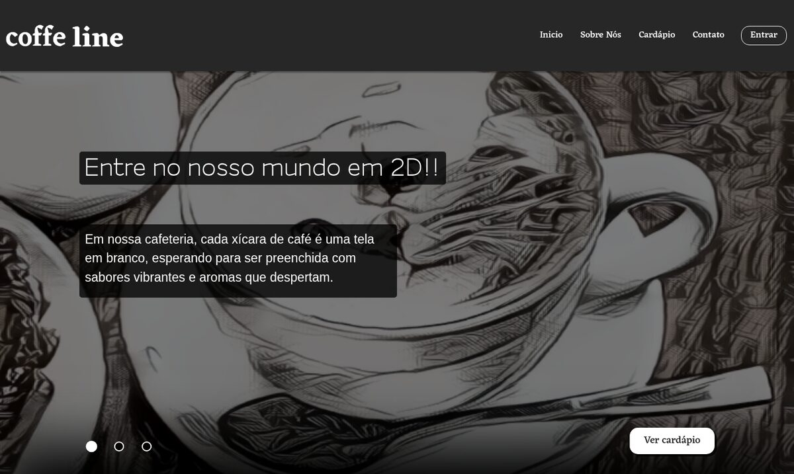
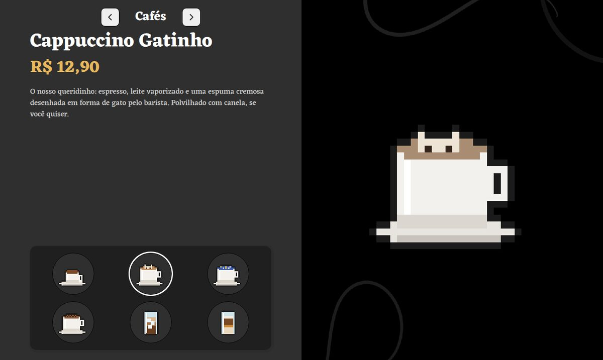
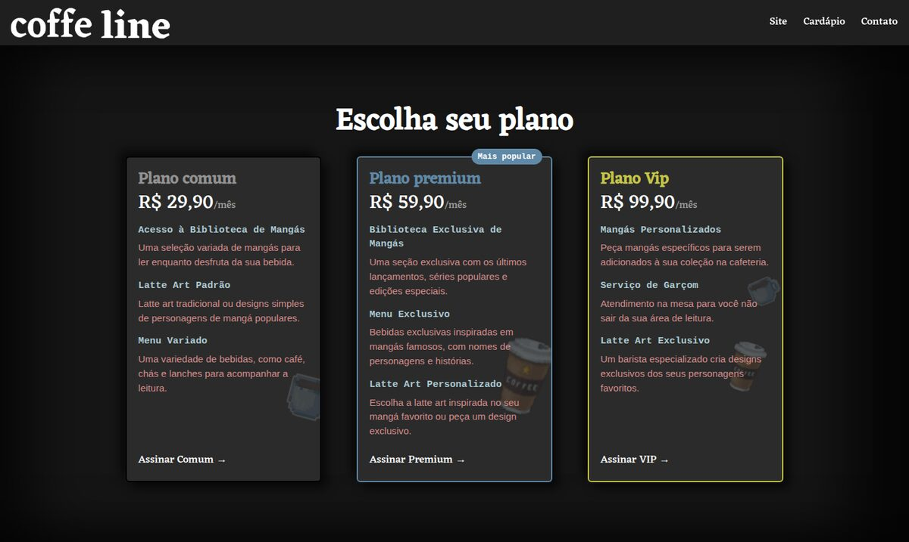
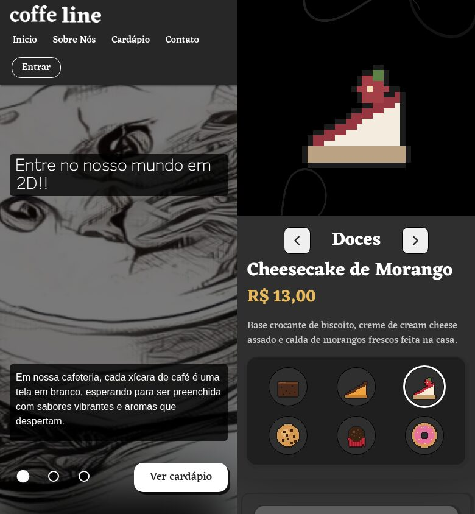

<div align="center">


# coffe line

**café, quadrinhos e arte na mesma xícara**


</div>

<br>



Site de uma cafeteria fictícia onde cada xícara é uma tela em branco. Mangás e HQs pra ler na mesa, latte art de gato e de Van Gogh e um cardápio inteiro desenhado em pixel art.

Feito só com HTML, CSS e JavaScript, sem framework e sem dependência nenhuma.

## o que tem

- **banner** com três cenas que vão passando sozinhas: o latte de gatinho, a parede de gibis e a noite estrelada
- **cardápio** com bebidas, cafés, salgados e doces, tudo em pixel art
- **sobre nós** contando como a ideia começou
- **planos** Comum, Premium e VIP, com cadastro, cupom de desconto e login
- **funciona no celular** do mesmo jeito que no computador

<br>





<p align="center">
  
</p>

## como rodar

Abre o `index.html` no navegador. Só isso.

Se preferir um servidorzinho local:

```bash
python3 -m http.server
```

e acessa `http://localhost:8000`.

## cupons

| código | desconto |
| ------ | -------- |
| `HXW2` | 10%      |
| `CAFE` | 15%      |

## estrutura

```
├── index.html          home
├── cadastro.html       planos e cadastro
└── static/
    ├── css/            estilos da home + fontes
    ├── css-form/       estilos do cadastro
    ├── JavaScript/     banner, cardápio e login
    ├── js-form/        validação do cadastro
    ├── img/            imagens do site
    │   └── cardapio/   pixel art dos produtos
    └── img-form/       fundos dos planos
```

<br>

<div align="center">
<sub>feito por <a href="https://github.com/cauekkz">cauê</a> ☕</sub>
</div>
